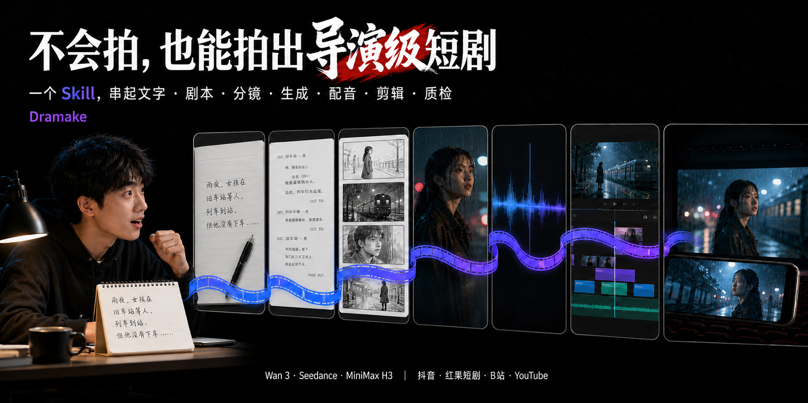

<div align="center">

# Dramake

### Turn one piece of text into a coherent, publishable AI short drama

A director-level Agent Skill for everyday creators. Start from an idea, copy, fiction, or screenplay—even without screenwriting, storyboarding, dubbing, or editing experience.

[简体中文](README.md) · [Quick start](#quick-start) · [Agent compatibility](#agent-compatibility) · [Workflow](#workflow) · [Model routing](#model-routing) · [Docs](#docs)

<p>
  <a href="https://github.com/xixihhhh/ai-short-drama-skill/releases/latest"></a>
  <a href="skills/dramake/SKILL.en.md"></a>
  <a href="tests/test_templates.py"></a>
  <a href="README.md"></a>
  <a href="#agent-compatibility"></a>
  <a href="LICENSE"></a>
</p>

<br>



</div>

> Dramake is not a prompt collection. It puts story, identity, camera, models, sound, budget, and QA into one traceable production line, so the result feels like one film instead of a pile of unrelated clips.

Use it with Codex, Claude Code, WorkBuddy, and other agents that support `SKILL.md` / Agent Skills. Built for Douyin, Hongguo Short Drama, WeChat Channels, Kuaishou, Bilibili, TikTok, YouTube, and more. It supports live action, standalone shorts, anthology episodes, serial drama, pet stories, anthropomorphic fantasy, motion comics, UGC, and branded narratives. The user always chooses the execution platform, API, MCP, and model surface.

<a id="quick-start"></a>

## One-minute quick start

Install:

```bash
npx skills add xixihhhh/ai-short-drama-skill --skill dramake
```

Then give your story directly to the agent:

```text
Use Dramake to turn the story below into a 90-second live-action family short.
Check that a cold viewer can understand the story before producing the script,
character canon, storyboard, model/cost route, dubbing plan, and QA criteria.
The Douyin version is 9:16 at 720p. Do not generate a dependent block until
its parent passes narrative, identity, physics, and audio review.
```

You can also enter at any stage: story diagnosis, script repair, storyboard, static-dialogue repair, voice unification, rough-cut review, or one failed shot.

<a id="agent-compatibility"></a>

## Agent compatibility

Dramake uses a standard `SKILL.md + references + assets` directory. Its core instructions do not depend on one chat product, although installation paths and tool permissions vary by agent.

| Agent / client | Compatibility route | Recommended install |
|---|---|---|
| **OpenAI Codex** | Current release validated for format, references, templates, and packaged installation | `npx skills add xixihhhh/ai-short-drama-skill --skill dramake` |
| **Claude Code** | Follows the Agent Skills / `SKILL.md` directory convention | Use a Skills installer or copy to `.claude/skills/dramake/` |
| **WorkBuddy** | Versions with local Skills can import the complete `dramake` directory | Copy into the user Skills directory; follow the current client's import surface |
| **Other Agent Skills clients** | Compatible when they load `SKILL.md` and can access sibling references/assets | Download [dramake.skill](https://github.com/xixihhhh/ai-short-drama-skill/releases/latest) or copy the folder |

Skill compatibility does not automatically provide a video-generation backend. The agent still needs the user's chosen website, API, MCP, local model, or generation tool; Dramake provides direction, routing, state, budget, and acceptance.

## How it differs from similar tools

Dramake is not a new video model or a generation website. It is a director-and-producer layer that organizes the user's chosen models, tools, and media into a stateful, budgeted, evidence-gated route to a final cut.

| Common alternative | Typical result | Dramake difference |
|---|---|---|
| **Video prompt library** | Good single-shot prompts without film-level state | Tracks story, character knowledge, wardrobe, props, action phase, voice, and audio boundaries |
| **One-click text-to-video platform** | Fast output, but the platform decides model, cost, and repair route | Provider-neutral; model, surface, quality tier, and spend authorization remain separate choices |
| **Shot-by-shot batch workflow** | Many five-second units that end as a clip pile | Separates long `generation_block` from short `edit_beat` to reduce seams without losing internal pace |
| **Face-only consistency tool** | Similar face, drifting wardrobe, phone, action, and voice | Long-term canon + accepted transient state + one authority per controlled dimension |
| **Generate every shot in parallel** | A bad parent silently contaminates every child | Independent work may parallelize; dependent story blocks wait for direct parent acceptance |
| **Image-quality-only review** | Beautiful frames with unclear story and fragmented sound | Four independent gates: narrative, identity/style, physics/continuity, and audio |
| **“Premium” as batch permission** | Unbounded retries and spend | Quality never implies authorization; uploads, candidates, retries, cap, and stop conditions are explicit |

### One entry point, eight built-in capabilities

You install one `dramake` Skill. The following are cooperating capability modules inside it—not eight fragmented Skills that require separate installation.

| Built-in capability | Responsibility | Main outputs |
|---|---|---|
| **Story Doctor** | Repairs causality, motive, setup, reversal, and pace from an idea, fiction, or script | Story contract, beat sheet, cold-viewer questions |
| **Visual Director** | Turns an emotional target into shot size, blocking, performance, camera, and cut motivation | Directing contract, storyboard, shot plan |
| **Continuity Keeper** | Tracks parent state, axis, action phase, props, wetness, light, and scene boundaries | Continuity ledger, accepted tail, transition plan |
| **Identity & Style Lock** | Locks people/animals/products, wardrobe topology, recurring props, text plates, materials, and portrait/landscape rules | Character/prop bibles, medium canon, reference-authority matrix |
| **Voice & Audio Director** | Unifies speaker, voice, lip-sync route, ambience, music, and J/L cuts | Voice Bible, audio continuity, mix map |
| **Model Router** | Routes Wan 3, Seedance, MiniMax H3, or other models by actual capability | Replaceable model cards and per-block route |
| **Budget Guard** | Separates quality from spend permission and calculates candidates, retries, and caps | Cost plan, authorization mode, spend ledger |
| **QA & Repair** | Reviews frames/audio/story/physics/drift and chooses the smallest repair | QA report and keep/post/edit/reroll/rewrite decision |

<a id="workflow"></a>

## From Text to Final Cut

| Stage | What Dramake does | Acceptance gate |
|---|---|---|
| **01 Story** | Extracts protagonist, desire, obstacle, escalation, plant, and payoff | A cold viewer can state the goal, action, and result |
| **02 Canon** | Locks character, wardrobe, material, location, recurring props, text plates, voice, and medium | One authoritative reference per controlled dimension |
| **03 Direction** | Designs intention, value turn, beats, shot size, performance, and movement | Every shot can answer “why film it this way?” |
| **04 Generation route** | Selects models by long duration, dialogue, keyframes, audio reference, edit, and budget | Quality tier and spend authorization remain separate |
| **05 Evidence review** | Downloads real outputs and inspects frames, sound, physics, and continuity | A dependent block unlocks only after parent acceptance |
| **06 Final post** | Continuity edit, dubbing, ambience, score, J/L cuts, and mix | Picture, story, and sound feel like one production |

### Two timescales

- `generation_block`: an 8–30s model request and continuity container that reduces external seams;
- `edit_beat`: a 2–8s unit of information, action, reaction, dialogue, or cutting that maintains pace.

Long generation does not mean a static long take. A 20–30s block usually needs 4–6 observable beats and motivated internal cuts or phase changes.

## What it is designed to fix

| Common failure | Dramake response |
|---|---|
| The story jumps locations and viewers get lost | Story contract, character knowledge state, scene bridges, and cold-viewer gate |
| One line ends and the actor freezes | Dialogue, concurrent action, listener reaction, micro-performance, and exit action |
| Multiple clips feel randomly concatenated | Accepted tail state, axis, action phase, audio boundary, and motivated transition |
| Face, coat, wardrobe, or prop drifts | Long-term canon + accepted transient state + reference-authority matrix |
| A stamp, scale, helmet, or printed prop mutates across scenes | Neutral-light multi-view prop bible + `prop/state/text_plate` IDs + exact text composited in post |
| Penetration, extra limbs, or a flipped phone | `approach → contact → force → response → stable outcome` physics gate |
| Reverse moves forward, steering/detachment never occurs | World/screen motion vectors + visible phases + stable end state, accepted from frame evidence |
| A collision stays in a flat distant observer shot | Setup, approach, near-lens occlusion/scale growth, impact endpoint, camera response, and consequence |
| Voice, room tone, and music change every clip | Voice ID, reference audio, human A/B, continuous ambience, and unified mix |
| “Premium” silently turns into unlimited spend | Separate model, execution surface, quality, authorization, and retry cap |

<a id="model-routing"></a>

## Model routing without platform lock-in

Before every run, verify the active surface's duration, references, audio, editing, resolution, price, and retention rules. This table is a testing starting point, not a permanent ranking.

| Model family | First task to test | Primary risk |
|---|---|---|
| **Wan 3** | 20–30s multi-beat blocks, fewer external seams, 720p economy/balanced work | Late identity, wardrobe, anatomy, and style drift |
| **Seedance 2.5** | High-value dialogue, audio/image/video references, edit, extend, and repair | Reference overload and cost |
| **Seedance 2.0** | 4–15s dialogue, action, transition, and balanced shots | More external joins in a long film |
| **Seedance 2.0 Fast** | Preview, coverage, alternates, and economy tests | Still needs strict review before final use |
| **MiniMax H3** | 4–15s hero motion, first/last-frame control, and key audiovisual beats | No need to spend it on every ordinary shot |

Other models can be added. Dramake routes by capability, not brand loyalty.

## Landscape, portrait, and multiple formats

| Deliverable | Content profile | Release format |
|---|---|---|
| 15–45s hook-driven microshort | Live action, pet, brand, UGC | `9:16` for Douyin / TikTok / Shorts |
| 45–120s standalone short | Family, comedy, fantasy, action, animation | `9:16`, `16:9`, or `1:1` |
| 1–4 minute anthology episode | Stable cast/world; one resolved problem per episode | Independently designed portrait or landscape |
| 1–4 minute serialized drama | Persistent relationship, knowledge, injury, prop, and season state | Douyin, Hongguo Short Drama, and other channels |

Portrait and landscape versions share story, character, prop, voice, and continuity canon, but receive separate composition, shot size, motion path, caption area, and cover-safe review. One version is not blindly cropped into the other.

## Audio and dubbing

Dramake can route each scene through native dialogue, reference audio, external dubbing/TTS, voice-over, or hybrid post. Native speech prioritizes lip sync and performance; recurring characters use separate Voice IDs and rights-cleared anchors; ambience, music, phone voices, and defective audio are unified in post.

Random generated music is never concatenated directly into the final mix. Same-scene ambience continues across cuts, with J/L cuts, dialogue ducking, and loudness matching so the film also holds together with eyes closed.

## Reliability gates

| Verification | Current status |
|---|---:|
| Automated repository tests | **17 passed** |
| Chinese/English document pairs | **30 passed** |
| Official Skill-format validation | **Passed** |
| Complete valid production plan | **Accepted** |
| Bad parent dependency, sparse long block, overlong shot, unknown voice | **Rejected** |

These checks validate workflow, file structure, and planning constraints—not unconditional model quality. Capabilities and prices are rechecked at execution time; candidate quality depends on direct video/audio inspection, frame review, physics, and cold-viewer results.

<a id="docs"></a>

## Documentation and tools

| Entry | Purpose |
|---|---|
| [Chinese Skill](skills/dramake/SKILL.md) · [English Skill](skills/dramake/SKILL.en.md) | Full workflow and trigger guidance |
| [Directing, camera, and pacing](skills/dramake/references/en/directing-camera-and-pacing.md) | Intention, camera contract, internal cuts, and pacing curve |
| [Identity, voice, and reference locks](skills/dramake/references/en/identity-voice-and-reference-locks.md) · [Recurring prop bible](skills/dramake/assets/templates/en/prop-bible.md) | Character, wardrobe, recurring/text props, material, voice, and reference authority |
| [Continuity and transitions](skills/dramake/references/en/continuity-and-transitions.md) | Parent state, tail frames, re-anchoring, and scene boundaries |
| [Dialogue, dubbing, and mix](skills/dramake/references/en/audio-and-dubbing.md) | Native speech, reference audio, external dubbing, and sound continuity |
| [Model routing](skills/dramake/references/en/model-router.md) · [Spend authorization](skills/dramake/references/en/authorization-and-batch.md) | Replaceable models, budget, batching, and stop conditions |
| [Physics and failures](skills/dramake/references/en/physics-and-failure-modes.md) · [QA and repair](skills/dramake/references/en/qa-and-repair.md) | Penetration, anatomy, text, phone direction, and minimal repair |
| [Anonymized observations](benchmarks/tested-observations.en.md) · [Validation report](evals/benchmark-report.md) | Observed failures and evidence limits |

<details>
<summary><strong>Local validation commands</strong></summary>

```bash
python3 scripts/validate_plan.py \
  --continuity skills/dramake/assets/templates/continuity-ledger.csv \
  --block-manifest skills/dramake/assets/templates/block-manifest.csv \
  --shot-plan skills/dramake/assets/templates/shot-plan.csv \
  --voice-bible skills/dramake/assets/templates/voice-bible.csv \
  --audio-continuity skills/dramake/assets/templates/audio-continuity.csv \
  --cost skills/dramake/assets/templates/cost-plan.csv

python3 -m unittest discover -s tests
python3 scripts/check_bilingual.py
```

</details>

## Examples

| Project | Best for exploring |
|---|---|
| [90s live-action family drama](examples/live-action-90s/README.en.md) | Human performance, causality, and dialogue |
| [90s pet-led standalone](examples/standalone-90s/README.en.md) | Live-action cuteness, species behavior, and contact |
| [Anthology episode](examples/anthology-episode/README.en.md) | Recurring cast with per-episode payoff |
| [Serialized drama](examples/serialized-episode/README.en.md) | Relationship, knowledge, and prop state across episodes |

Examples are production manifests. They never present unreviewed model output as a finished film.

## Install, contribute, and license

- Download the latest package: [Dramake Releases](https://github.com/xixihhhh/ai-short-drama-skill/releases/latest)
- Report failures or model compatibility: [Issues](https://github.com/xixihhhh/ai-short-drama-skill/issues)
- Improve the project: [Contributing](CONTRIBUTING.en.md)
- License: [MIT](LICENSE)

<div align="center">

**Start from text. Accept with evidence. Turn clips into a film.**

</div>
