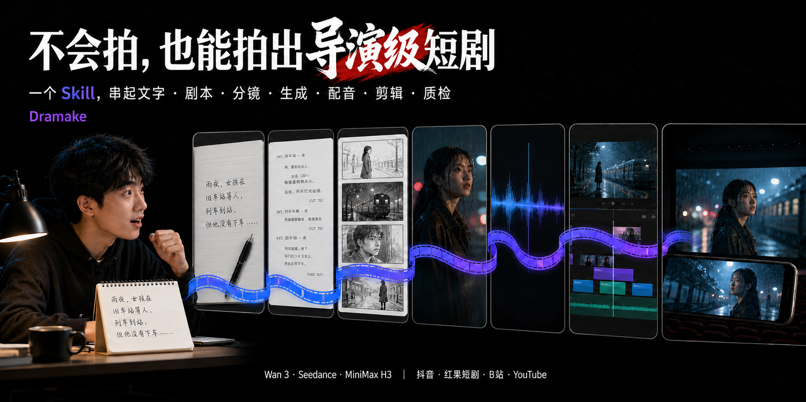

# Dramake — 文字转 AI 短剧的连续性导演

[English](README.en.md)



[](LICENSE)


[](CONTRIBUTING.md)

Dramake 是给普通创作者的文字转短剧 Skill：即使不会编剧、分镜、配音或剪辑，也能从一个点子、一段文案、小说或剧本出发，由一个 Skill 串起故事、分镜、生成、配音、剪辑和质检，做出能看懂、能衔接、能发布的导演级 AI 短剧与 AI 短片。

Dramake 面向抖音、红果短剧、视频号、快手、B站、YouTube 等渠道，支持真人短剧、独立短片、单元剧、连续剧、萌宠故事、拟人奇幻、漫剧、UGC 与品牌剧情。它重点解决剧情断裂、碎片硬拼、人物/服装漂移、站桩对白、穿模、口型与声线不一致、音乐反复重启、付费失控和成片无法上线。

平台、接口和生成工具由用户自行选择。Skill 根据当前能力、价格、隐私与素材上传规则选路，不锁定单一网站、API、MCP 或服务商。

## 从文字到成片

`原始文字 → 故事诊断 → 剧情合同 → 剧本/节拍 → 角色与世界母版 → 分镜/生成段 → 模型与费用路由 → 候选视频 → 证据质检 → 连续性剪辑 → 配音/混音 → 冷观众检查 → 发布`

输入可以是一个点子、一段文案、小说章节、完整剧本、分镜表、参考图或已有视频。任务可以只停在诊断、改剧本、做生产包，也可以继续执行和修片。

## 支持范围

- 15–45 秒强钩子小短片、广告和账号起量内容；
- 45–120 秒完整独立短片；
- 1–4 分钟真人、动画、宠物、奇幻、UGC 或品牌剧情；
- 固定角色与世界规则的单元剧；
- 有季线、关系、知识和道具状态的连续短剧；
- 小说、长文、故事梗概与现有脚本改编；
- 原生对白、参考音频、外部配音/TTS、口型同步和混合后期；
- `9:16`、`16:9`、`1:1` 与自定义画幅。

## 五个核心设计

### 1. 生成段与剪辑节拍分开

`generation_block` 是 8–30 秒的模型请求与连续性容器；`edit_beat` 是 2–8 秒的信息、动作、反应、对白和切镜单位。长段减少外部接缝，但内部仍要有 3–6 个明确变化，避免“一句话站十秒”。

### 2. 上游验收后才解锁下游

独立定妆、声线、音乐探索、备选开头和非依赖插镜可以并行；连续剧情必须先下载上游成片、抽帧、听音频并检查剧情、身份、物理和尾部状态。只有“验收尾部状态 + 角色/材质母版 + 连续性账本”才能解锁下一段。

### 3. 模型、执行平台、质量和付费授权分开

- 模型按长段、首尾帧、参考音频、原生对白、编辑/续写和分辨率等能力选路；
- 执行平台由用户选择；
- 质量档为 Sketch / Economy / Balanced / Premium / Hero Insert / Final Polish；
- 授权档为 plan-only / single-test / approved-batch / autopilot-with-cap。

选择 Premium 不等于授权无限花费。批量模式必须记录允许上传的素材、请求数、重试数、预算上限和停止条件。

### 4. 配音是独立生产线

- 模型原生对白优先口型与表演；
- 参考音频锁定角色声线、语速、口音与情绪；
- 外部配音/TTS 结合口型工具、反应镜头、侧脸、远景、插镜和画外音；
- 混合方案保留好的原生台词和拟音，旁白、电话声、环境与 BGM 后期统一；
- 无对白项目使用连续环境底、单一音乐结构和精选拟音。

随机生成的音乐不会直接裸拼成终片。

### 5. 技术过关不等于剧情能发

终片分别通过剧情可懂性、身份/画风、物理/连续性和声音四道门。未读梗概的冷观众也必须能复述：谁想要什么 → 被什么阻挡 → 做了什么 → 为什么得到这个结果。

## 横屏与竖屏

项目开始时锁定发布渠道、画幅、安全区、主体大小、字幕区和封面裁切区。同一项目需要横竖双版本时，共用剧情、角色、场景、道具、声线和连续性账本，但分别设计构图、景别、运动路径与字幕安全区，并分别验收。

默认不把 16:9 成片直接居中裁成 9:16，也不把 9:16 画面机械补边成 16:9。

## 模型路由

每次执行前核实当前入口的参数、时长、参考素材限制、音频能力、队列、存储规则和价格。下表是起始假设，不是永久排名，也不限制其他模型。

| 模型系列 | 优先测试任务 | 主要风险 |
|---|---|---|
| Wan 3 长段生成 | 20–30 秒多节拍剧情段、减少外部接缝、720p 经济/均衡档 | 后半段身份、服装、骨骼与画风漂移 |
| Seedance 2.5 多模态 | 高价值对白、参考音频、多图/视频参考、编辑、续写与修复 | 成本与参考过载 |
| Seedance 2.0 | 4–15 秒对白、动作、过渡和均衡档镜头 | 长片外部接缝更多 |
| Seedance 2.0 Fast | 预演、覆盖、备选和经济档测试 | 进终片前仍需严格质检 |
| MiniMax H3 音画生成 | 4–15 秒高运动重点镜头、首尾帧控制和关键音画段 | 不适合把全部普通镜头都做成高成本段 |

## 内容配置

| 配置 | 必须锁定 |
|---|---|
| 真人剧情 | 脸、手、年龄、发型、服装结构、视线、轴线、表演与关系认知 |
| 宠物/动物 | 物种解剖、毛色地图、眼睛、比例、行为、接触与人物关系 |
| 拟人/奇幻 | 身体结构、拟人程度、能力触发、限制、代价与后果 |
| 动画/漫剧 | 设计语法、线条、阴影、比例、动作节奏与背景层级 |
| 品牌/产品剧情 | 几何、材质、比例、标签安全区、合规说法与剧情功能 |
| UGC/口播/访谈 | 说话人、镜头语法、信息密度、自然瑕疵、动作与房间底噪 |

## 安装

```bash
npx skills add xixihhhh/ai-short-drama-skill --skill dramake
```

手动安装：

```bash
git clone https://github.com/xixihhhh/ai-short-drama-skill.git
cp -R ai-short-drama-skill/skills/dramake ~/.codex/skills/dramake
```

## 调用示例

```text
使用 Dramake，把这篇故事做成 90 秒真人家庭短剧。
先保证普通观众能看懂人物目标、阻碍、选择和结果，再做分镜与模型路由。
抖音版 9:16，横屏版 16:9；两版共用角色和声线，但分别构图验收。
给我 Economy 和 Balanced 两套费用方案。上游片段通过剧情、连续性、物理和声音检查后，
再生成依赖它的下一段。
```

## 质量与付费模式

1. **Sketch**：最低可用预演，只验证剧情与调度；
2. **Economy**：通常 720p，长段优先，只修失败单元；
3. **Balanced**：把强模型、参考和音频用在真正提高通过率的位置；
4. **Premium**：富多模态、参考音频、编辑/续写与选择性高分辨率；
5. **Hero Insert**：集中预算做钩子、脆弱对白、变形、动作、揭示或高潮；
6. **Final Polish**：只放大、修复、调色和混音已验收素材。

付费授权档：`plan-only`、`single-test`、`approved-batch`、`autopilot-with-cap`。费用账本同时记录报价、实付和 `cost_per_accepted_second`（每个可用成片秒数的成本）。

## 物理、连续性与文字门禁

所有接触动作必须可见：`接近 → 接触 → 施力 → 物体/身体响应 → 稳定结果`。

直接拒绝：人物或物体穿透、动物数量变化、额外肢体、悬空无支撑、道具瞬移、手机正反面反转、服装结构突变、无解释的位置/时间跳变、湿度或破损状态复原。

视频模型不擅长稳定渲染文字、手机屏幕、信件、价签和倒计时。默认生成干净留白或替代性视觉证据，具体文字后期叠加。

## 文档与工具

- [主 Skill](skills/dramake/SKILL.md)
- [英文 Skill](skills/dramake/SKILL.en.md)
- [内容配置](skills/dramake/references/content-profiles.md)
- [生成段与剪辑节拍](skills/dramake/references/generation-blocks-and-edit-beats.md)
- [导演、镜头、运镜与节奏](skills/dramake/references/directing-camera-and-pacing.md)
- [角色、声线与参考素材锁](skills/dramake/references/identity-voice-and-reference-locks.md)
- [模型路由](skills/dramake/references/model-router.md)
- [批量付费与授权](skills/dramake/references/authorization-and-batch.md)
- [对白、参考音频与配音](skills/dramake/references/audio-and-dubbing.md)
- [连续性与转场](skills/dramake/references/continuity-and-transitions.md)
- [物理与失败检查](skills/dramake/references/physics-and-failure-modes.md)
- [匿名实测记录](benchmarks/tested-observations.md)

```bash
python3 scripts/validate_plan.py \
  --continuity skills/dramake/assets/templates/continuity-ledger.csv \
  --block-manifest skills/dramake/assets/templates/block-manifest.csv \
  --shot-plan skills/dramake/assets/templates/shot-plan.csv \
  --voice-bible skills/dramake/assets/templates/voice-bible.csv \
  --audio-continuity skills/dramake/assets/templates/audio-continuity.csv \
  --cost skills/dramake/assets/templates/cost-plan.csv
python3 -m unittest discover -s tests
python3 scripts/check_bilingual.py
```

## 示例

- [真人家庭短剧](examples/live-action-90s/README.md)
- [宠物主角独立短片](examples/standalone-90s/README.md)
- [单元剧](examples/anthology-episode/README.md)
- [连续短剧](examples/serialized-episode/README.md)

示例是制作清单，不宣称未验收的生成结果已经是成片。

## 许可证

MIT，见 [LICENSE](LICENSE)。Dramake 是独立社区项目。
